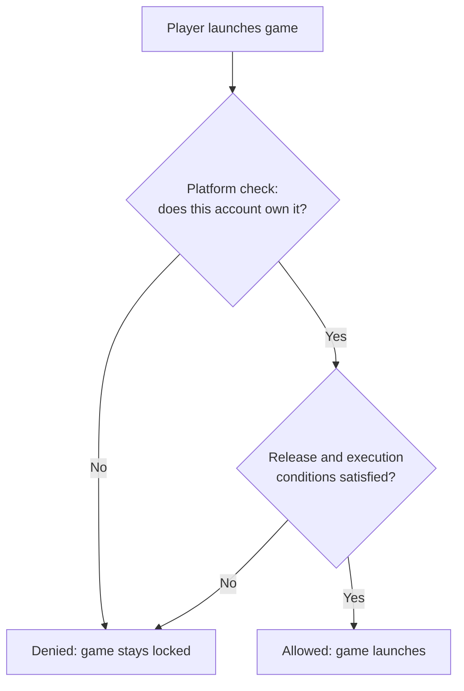
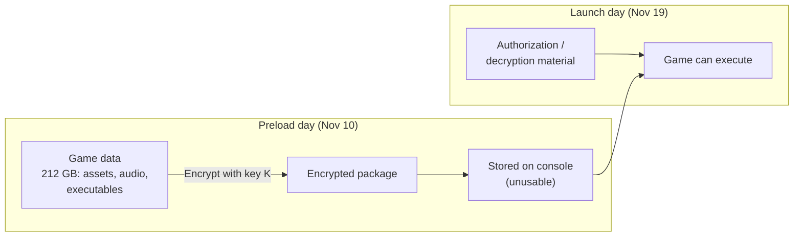
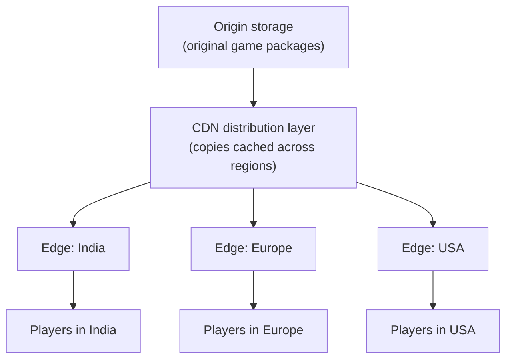
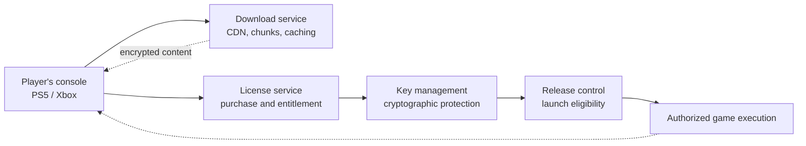

# Downloaded ≠ Playable: The Engineering Behind AAA Game Preloads

*A system-design walkthrough of encryption, DRM, trusted time, and CDNs, using the GTA VI launch and the Forza Horizon 6 leak as case studies.*

| | |
|---|---|
| **Topics** | Cryptography · DRM · Key management · CDNs · Distributed systems · Trusted time |
| **Level** | Intermediate (great for backend / system-design interview prep) |
| **Written** | November 19, 2026 (GTA VI's scheduled launch day) |

---

## Table of Contents

1. [The case study: GTA VI's launch](#1-the-case-study-gta-vis-launch)
2. [Can you beat a release date by changing the console clock?](#2-can-you-beat-a-release-date-by-changing-the-console-clock)
3. [What happens if you go offline?](#3-what-happens-if-you-go-offline)
4. [Encrypted preload, explained](#4-encrypted-preload-explained)
5. [The Forza Horizon 6 leak](#5-the-forza-horizon-6-leak)
6. [Why preload at all? The bandwidth math](#6-why-preload-at-all-the-bandwidth-math)
7. [How CDNs absorb the load](#7-how-cdns-absorb-the-load)
8. [Two problems, solved at two different times](#8-two-problems-solved-at-two-different-times)
9. [How might the "unlock" actually work?](#9-how-might-the-unlock-actually-work)
10. [Why not make the game playable right after download?](#10-why-not-make-the-game-playable-right-after-download)
11. [The big picture: a reference architecture](#11-the-big-picture-a-reference-architecture)
12. [Computer science concepts at play](#12-computer-science-concepts-at-play)
13. [Interview questions](#13-interview-questions)
14. [Key takeaway](#key-takeaway)
15. [Sources](#sources)

---

## TL;DR

- **Downloading, owning, decrypting, and being authorized to run a game are four different things**, handled by different systems.
- Preloading lets a publisher move a ~200 GB payload **days before launch**, so launch day only needs a small *authorization* step instead of a massive *download*.
- Changing your console's clock is **not a reliable bypass**, because release status is enforced by platform entitlement and licensing, not just local time.
- Encryption only protects you if **key management and build distribution** are done correctly. The Forza Horizon 6 incident is a reminder of this, even though its exact cause was not publicly established.

> **A note on accuracy.** Throughout this article, I separate three kinds of claims: **officially confirmed** (from Rockstar, PlayStation, or Microsoft), **reported** (from journalists), and **general technical explanation** (how such systems commonly work). Rockstar and Sony have **not** publicly documented GTA VI's internal launch-validation or encryption design, so any architecture shown here is illustrative.

---

## 1. The case study: GTA VI's launch

**Officially documented facts** (per Rockstar's support documentation):

| Detail | Value |
|---|---|
| Game | Grand Theft Auto VI |
| Platforms | PlayStation 5, Xbox Series X\|S |
| Official release date | **November 19, 2026** |
| Release time | Midnight local time, in all regions |
| Preload start | **November 10, 2026** |
| PS5 preload | Began at midnight local time |
| Xbox preload | Began globally at 12 AM GMT |
| Maximum preload size | Up to **212 GB** |

Since today is November 19, the scheduled launch has arrived. Now for the interesting part: the engineering that makes a day-one launch work.

---

## 2. Can you beat a release date by changing the console clock?

**Short answer: changing the console clock is not a reliable way to bypass release restrictions.**

Suppose you preload GTA VI on November 10. Your console now holds all 212 GB of files, but *having the files* and *having permission to run them* are separate things.

> **Analogy**
> - Downloading the game = receiving a **locked box**.
> - Owning the game = having the **right** to open the box.
> - Release time = the **condition** under which opening is allowed.

### Possible layers of protection

**Layer 1: Platform entitlement.** The platform knows whether *your account* has acquired the game. Account A bought it; Account B did not. The platform can tell them apart.

**Layer 2: Release-time restriction.** The platform can enforce a release window tied to the purchase or license. Changing the *local* clock doesn't necessarily change the *authoritative* release status.

**Layer 3: Game-level protection.** The game itself may add checks such as license validation, integrity checks, or online activation, depending on its design.

### Conceptual launch validation

*Illustrative architecture, not a confirmed diagram of Rockstar's or Sony's internal implementation.*

---

## 3. What happens if you go offline?

It's tempting to think: *"If my console can't talk to Rockstar or Sony, how can it know the game isn't released yet?"*

The key insight: **offline execution and online authorization are different things.**

A game you've already purchased and authorized can carry **locally stored license information** that permits offline play. PlayStation even has a feature called *Console Sharing and Offline Play*, and its GTA VI support page asks players to check this setting.

### A simplified offline-DRM flow

1. The console connects to the platform.
2. The platform verifies the purchase.
3. The console receives and stores authorization information.
4. The console can use that authorization offline, subject to platform rules.

Think of it as an **access card that was issued and validated earlier**.

### The catch

If a game has *never* received its required authorization, or its release conditions aren't yet satisfied, **disconnecting from the internet doesn't create permission.**

- Going offline doesn't make security checks disappear.
- Local licenses can support legitimate offline play.
- Online checks may still be needed for initial activation or certain features.

> For GTA VI specifically, there is no public technical documentation confirming which checks can be completed offline before or after launch.

---

## 4. Encrypted preload, explained

There is a real, widely used mechanism in the games industry called **encrypted preload**.

Imagine a developer with a finished 200 GB game. They want customers to download it ten days early, but **not** be able to run it before launch. One approach: distribute the content **encrypted**.

*Conceptual encrypted-preload model. The actual PlayStation/Xbox implementation for GTA VI has not been publicly disclosed.*

The big win: the player already holds the real content. On launch day, only **small authorization material and any remaining updates** need to be delivered, not 212 GB all over again.

### A little cryptography

With symmetric encryption, the idea is:

$$C = E_K(P)$$

$$P = D_K(C)$$

| Symbol | Meaning |
|---|---|
| $P$ | Original game data (plaintext) |
| $K$ | Encryption key |
| $E$ | Encryption algorithm |
| $D$ | Decryption algorithm |
| $C$ | Encrypted game data (ciphertext) |

The key is what makes decryption possible.

### Real systems are more nuanced

Production systems can use **multiple keys, encrypted content packages, platform-specific licenses, and hardware-backed security**. It's not necessarily one giant key broadcast to every console at midnight.

> **Distinction worth remembering:** Steam's encrypted-preload behavior is publicly documented through its observable behavior and detailed reporting. That does **not** mean PlayStation or Xbox use the identical implementation.

---

## 5. The Forza Horizon 6 leak

A recent real-world example shows why preload security matters.

**What was reported:**

- On **May 10-11, 2026**, a playable PC build of *Forza Horizon 6* appeared online before its official release.
- **Ars Technica** reported roughly **155 GB** of game files on Steam in *unencrypted* form. Steam normally supports encrypted preloads, where a game downloads early and becomes usable only when the key is released.

**An important correction:**

- Microsoft subsequently stated that the leak was **not the result of a preload issue**.
- The precise source of the leaked build was **not publicly established** in that statement.

So the tidy theory, *"someone forgot to encrypt the Steam preload,"* should **not** be presented as confirmed fact.

### Why it's still instructive

It illustrates a core security principle:

> **Encryption only protects data if the encryption *and* key-management process are implemented correctly.**

A company can encrypt a build perfectly. If it then exposes the key, or ships an unprotected build to someone who shouldn't have it, the algorithm's strength is irrelevant. The failure is in **key management and distribution**.

Security engineers therefore care about:

- Encryption at rest
- Key management
- Access control
- Secure build pipelines
- Release authorization
- Audit logs

---

## 6. Why preload at all? The bandwidth math

Consider what happens if **10 million players** each download a 212 GB game:

$$10{,}000{,}000 \times 212\ \text{GB} \approx 2.12\ \text{exabytes}$$

*(decimal units)*

Now suppose all of that had to be delivered within **one hour**:

$$\frac{2.12 \times 10^{18}\ \text{bytes} \times 8}{3600\ \text{s}} \approx 4.71\ \text{petabits per second}$$

That is an enormous aggregate bandwidth requirement.

> This is an **illustrative calculation** (10 million full downloads inside one hour), not Rockstar's actual traffic forecast. Its purpose is to show the *order of magnitude* of the problem preloading solves.

Spreading the download across **days** instead of **an hour** turns a catastrophic traffic spike into a manageable, smoother load.

---

## 7. How CDNs absorb the load

Companies solve distribution with **Content Delivery Networks (CDNs)**. Instead of every player pulling from one central server, files are replicated across many geographically distributed servers.

*Simplified CDN architecture.*

A player in India can download from a nearby edge location instead of fetching every byte from a central data centre.

### Supporting techniques

| Technology | What it accomplishes |
|---|---|
| CDN caching | Stores game files closer to players |
| Load balancing | Distributes requests across servers |
| Preloading | Spreads downloads over several days |
| Chunked downloads | Downloads files in smaller pieces |
| Resume support | Continues interrupted downloads |
| Checksums | Detects corrupted or modified files |
| Rate limiting | Prevents infrastructure overload |
| Regional distribution | Reduces long-distance network traffic |

### A subtle but important point

**Download infrastructure and authentication infrastructure are not necessarily the same system.** A CDN can serve game chunks without making a purchase-validation decision for every single chunk. The platform's licensing infrastructure handles authorization **separately**.

---

## 8. Two problems, solved at two different times

Releasing a huge game involves two distinct problems:

1. **Delivering 212 GB of data** (a bandwidth problem)
2. **Granting permission to execute it** (an authorization problem)

These don't need to be solved at the same moment. Think of a flight: you receive your ticket days before departure, but the plane still leaves on schedule.

| Date | What happens |
|---|---|
| **November 10** | Players download the game |
| **November 10-18** | Game remains subject to release restrictions |
| **November 19** | Scheduled launch and access authorization |
| **After launch** | Players download remaining patches and updates |

This separates the **enormous data-transfer workload** from the **small, time-critical authorization workload**. It is a very smart system-design decision.

---

## 9. How might the "unlock" actually work?

A natural theory: *the platform sends an encryption key to every console at midnight.* It's conceptually reasonable, but the precise implementation isn't public. Several designs are plausible:

| Design | Idea |
|---|---|
| **A. Decryption-key release** | The platform releases the needed decryption material when the game becomes eligible. |
| **B. License authorization** | The platform validates the user's purchase and issues or activates a license permitting execution. |
| **C. Combined approach** | Content is encrypted, *and* platform entitlement plus release-time checks decide whether the console may use it. |

Real systems frequently blend these.

A crucial cryptographic detail: secure systems generally **don't** transmit one universal plaintext game key to every console. They can use **device-specific or account-specific protection, key wrapping, secure hardware, and local license validation.**

> Nobody outside the companies can claim GTA VI uses one specific design without technical documentation.

---

## 10. Why not make the game playable right after download?

Because it would undermine the release strategy:

- Reviewers or players might leak the story or publish gameplay early.
- People could obtain the game without purchasing it.
- The publisher would lose control of the release schedule.
- Marketing and coordinated launch events could be disrupted.

The restriction isn't primarily about whether servers can *technically* handle the game. It's about **controlling access to the product until the agreed release time.**

---

## 11. The big picture: a reference architecture

*Conceptual architecture combining common industry mechanisms. It is **not** a verified Rockstar or Sony internal system diagram.*

---

## 12. Computer science concepts at play

| Concept | Where it appears |
|---|---|
| Distributed systems | Millions of players downloading simultaneously |
| CDN | Delivering large game files globally |
| Cryptography | Protecting preloaded game content |
| Key management | Controlling access to decryption material |
| Authentication | Identifying the player's account |
| Authorization | Checking whether the player owns the game |
| DRM | Preventing unauthorized execution |
| Trusted time | Enforcing release schedules |
| Load balancing | Distributing incoming traffic |
| Fault tolerance | Handling interrupted downloads and server failures |
| Integrity verification | Detecting modified or corrupted files |
| Rate limiting | Protecting infrastructure from excessive requests |

---

## 13. Interview questions

These are the kinds of questions you might see in a system-design or security interview. The right-hand column lists ideas a strong answer might touch on.

| # | Question | Ideas to consider |
|---|---|---|
| 1 | **20 million players try to download a 200 GB game at once. How do you design the infrastructure?** | Multi-region CDN, origin shielding, staged/regional rollout, preloading, rate limiting, chunking, capacity planning |
| 2 | **A game is encrypted during preload, but the decryption key is accidentally exposed. What mechanisms limit the damage?** | Per-build or per-region keys, key rotation, content watermarking, access auditing, server-side features gated behind online checks |
| 3 | **A player bought and downloaded a game, but the licensing server goes down on launch day. How do you avoid locking out legitimate customers?** | Cached licenses, grace periods, graceful degradation, redundant/multi-region license services |
| 4 | **How do you stop someone from changing their console clock to bypass release restrictions?** | Server-signed time, trusted/secure clocks, monotonic counters, tying release status to server-issued licenses |
| 5 | **How would you design a launcher that supports offline play but still blocks unauthorized access?** | Time-limited offline leases, signed local licenses, periodic re-validation, hardware-backed key storage |

---

## Key takeaway

> **Downloading software, owning software, decrypting software, and being authorized to execute software are four different things.**

To a player, they collapse into a single action: pressing **Play**. Underneath, they can involve entirely separate systems (CDNs, license servers, key management, and release control), each designed to scale and fail independently. That separation is the engineering beauty of modern digital game distribution.

---

## Sources

- [Rockstar: GTA VI Pre-Load FAQ](https://support.rockstargames.com/articles/7nPqOA2uCbpEQHXx7KVrYd/grand-theft-auto-vi-pre-load-faq)
- [Rockstar: Regional release and preload times (PS5 and Xbox Series X|S)](https://support.rockstargames.com/articles/29jV3Cv2cCgvwM1XgtMO5o/grand-theft-auto-vi-regional-pre-load-and-release-times-on-playstation-5-and-xbox-series-x-or-s)
- [PlayStation: GTA VI support and offline-play preparation](https://www.playstation.com/en-in/support/games/gta-vi-support/)
- [Ars Technica: Forza Horizon 6 preload and encryption incident](https://arstechnica.com/gaming/2026/05/pirates-are-already-playing-forza-horizon-6-days-before-its-launch/)
- [Windows Central: Microsoft's clarification on the Forza leak](https://www.windowscentral.com/gaming/xbox/what-an-insane-screw-up-xbox-itself-leaks-forza-horizon-6-pc-files-in-full-a-week-before-launch-and-pirates-already-cracked-it)

*These sources help separate what the companies officially announced, what journalists observed, and what can be inferred from established computer-science principles.*
